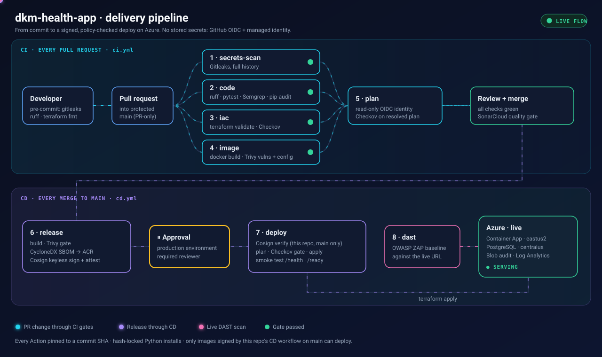
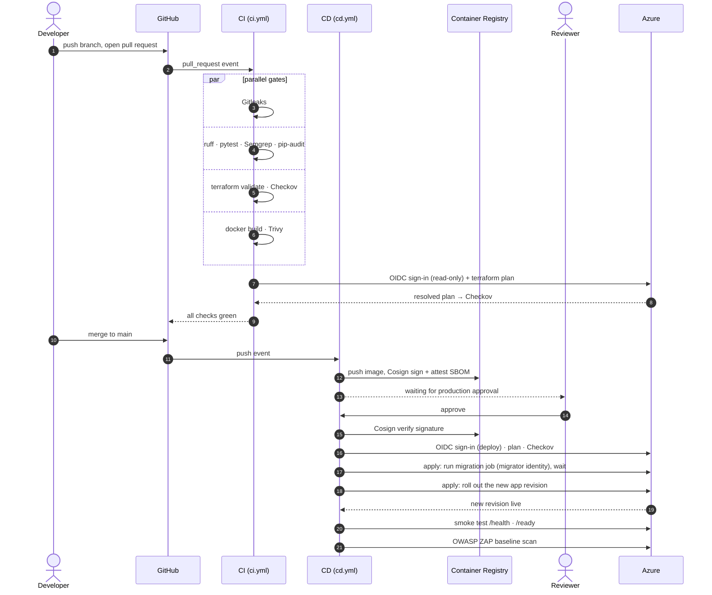
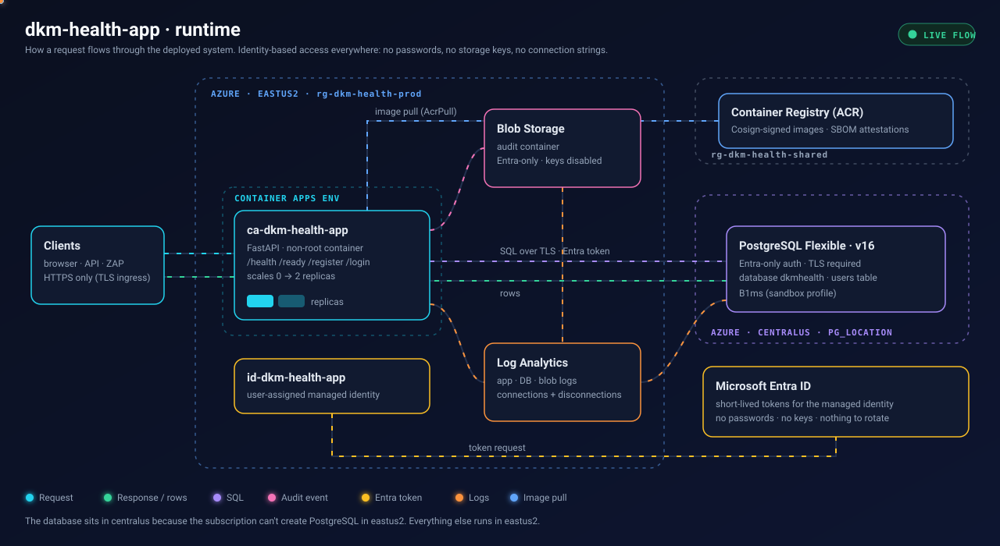
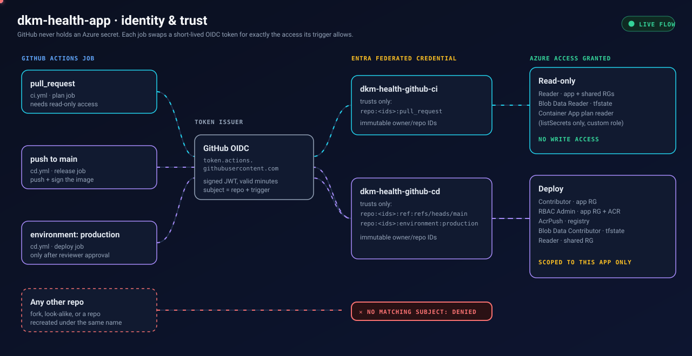

# Architecture

The badges above show live status: the latest CI and CD runs, and a link to the running app's health endpoint.
The diagrams below are animated. The moving packets trace the real paths a change, a request and a sign-in take
through this system.

- [1. Delivery pipeline](#1-delivery-pipeline)
- [2. A merge, step by step](#2-a-merge-step-by-step)
- [3. Runtime](#3-runtime)
- [4. Identity and trust](#4-identity-and-trust)
- [5. What's deployed](#5-whats-deployed)

---

## 1. Delivery pipeline

**CI** ([`ci.yml`](../.github/workflows/ci.yml)) runs on every pull request. Four gates run in parallel:
secrets, code, IaC and image. If all four pass, a `terraform plan` runs against the real Azure state with a
read-only identity, and Checkov checks the *resolved* plan. Reviewers see exactly what will change before
they approve.

**CD** ([`cd.yml`](../.github/workflows/cd.yml)) runs on every merge to `main` that can affect the app. Changes
that only touch `docs/`, Markdown, `LICENSE` or `scripts/` don't queue a production deploy.

| Stage | What it does | Fails the run when |
|---|---|---|
| 6 · release | build, Trivy scan, CycloneDX SBOM, push to ACR, Cosign keyless sign + SBOM attestation | a fixable HIGH/CRITICAL CVE is found, or signing fails |
| ⏸ approval | waits for a required reviewer on the `production` environment | — (it waits) |
| 7 · deploy | Cosign verify, `terraform plan`, Checkov plan gate, `apply` (runs schema migrations first), smoke test | the image wasn't signed by this repo's CD workflow on `main`, a policy is violated, or `/health` or `/ready` fails |
| 8 · dast | OWASP ZAP baseline against the live URL | report only; findings go to the backlog |

Only one production deploy runs at a time (`concurrency: deploy-production`), and a deploy is never interrupted
midway.

## 2. A merge, step by step

## 3. Runtime

- **Least privilege in the database.** The app's role can only `SELECT`, `INSERT` and `UPDATE` `app.users`: no
  DDL, no `DELETE`, no admin. CI proves this against a real PostgreSQL on every pull request.
- **Versioned migrations.** Schema changes are SQL files in [`app/migrations/`](../app/migrations), applied once,
  in order, by the `caj-dkm-health-migrate` Container Apps job. It runs as a separate *migrator* identity (the
  database's only Entra admin) that is never attached to the API. `terraform apply` runs the job and waits for it
  before rolling out the new app revision, so new code never runs against an old schema.
- **No secrets at runtime.** The container app runs as a user-assigned managed identity. Microsoft Entra ID issues
  it short-lived tokens for PostgreSQL and Blob Storage. Database passwords and storage keys are switched off.
- **Two regions.** The database runs in `centralus` (the `PG_LOCATION` repo variable), because this subscription
  can't create PostgreSQL in `eastus2`. Everything else runs in `eastus2`. Changing `PG_LOCATION` later recreates
  the server, so it's set once, before the first deploy.
- **Audit trail.** Every register and login attempt writes an audit event to the `audit` blob container. Database
  connections, disconnections and blob access are sent to Log Analytics.
- **Scale to zero.** The sandbox profile runs 0–2 replicas. The first request after an idle period starts a
  replica, which takes a few seconds.

## 4. Identity and trust

GitHub Actions signs in to Azure with OIDC, so no Azure credentials are stored in GitHub. Each job gets a token
whose *subject* names this repository and the trigger. Entra exchanges it only if a federated credential matches:

| Trigger | Identity | Access |
|---|---|---|
| `pull_request` | `dkm-health-github-ci` | read-only: Reader on both resource groups, read on Terraform state, and a custom role whose only permission is `listSecrets` on the container app, which `terraform plan` needs |
| push to `main`, `environment: production` | `dkm-health-github-cd` | deploy: Contributor + RBAC Administrator on the app resource group, AcrPush, write on Terraform state |

The subjects use GitHub's **immutable owner and repository IDs**, not names. A deleted-and-recreated repo, or a
look-alike with the same name, can't inherit this access. All of this is set up by
[`scripts/bootstrap-azure.sh`](../scripts/bootstrap-azure.sh).

## 5. What's deployed

Terraform ([`infra/`](../infra)) manages 20 resources in `rg-dkm-health-prod`. Bootstrap creates the shared
registry and the Terraform state storage once, in `rg-dkm-health-shared`.

| Area | Resources |
|---|---|
| App hosting | Container Apps environment `cae-dkm-health` (Consumption profile), container app `ca-dkm-health-app` |
| Identity | managed identities `id-dkm-health-app` (API) and `id-dkm-health-migrator` (migrations); AcrPull for both; Storage Blob Data Contributor on the audit container for the API |
| Database | PostgreSQL Flexible Server v16 `psql-dkm-health-<suffix>`, database `dkmhealth`, Entra admin (the migrator identity), firewall rule, connection logging |
| Migrations | Container Apps job `caj-dkm-health-migrate`, plus the apply step that runs it and waits for it |
| Storage | storage account `stdkmhealth<suffix>` with the `audit` container |
| Observability | Log Analytics workspace `log-dkm-health-<suffix>`; diagnostic settings for blob storage and PostgreSQL |

`<suffix>` is the first 6 hex characters of `sha256(subscription ID)`, so every name is known at plan time and
checked by policy before anything is created. Sizing (replicas, SKUs, redundancy, retention) comes from the
deployment profile in [`infra/profiles.tf`](../infra/profiles.tf). See README section 7.
